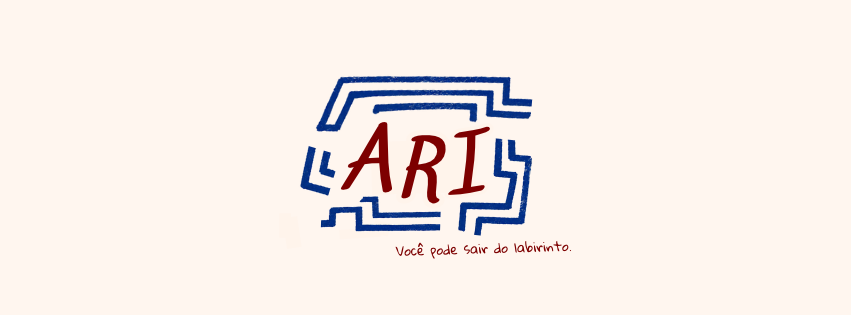

<h1 align="center"> ARI </h1>

 Apoio ao autocuidado e ao monitoramento de comportamentos aditivos por meio de atividades cognitivas. 

O ARI é um projeto desenvolvido para fins acadêmicos como requisito do 1º período na disciplina de **Projeto interdisciplinar para Sistemas de Informação** do curso de Bacharelado em Sistemas de Informação da [Universidade Federal Rural de Pernambuco (UFRPE)](https://ufrpe.br).

## 🧶​ Sobre o projeto 

O ARI é um projeto que propõe uma aplicação de apoio ao autocuidado e ao acompanhamento pessoal, voltado a pessoas que lidam com comportamentos aditivos e hábitos compulsivos.

A aplicação reúne recursos para registrar, acompanhar e organizar  comportamentos e seus momentos de gatilhos. Além disso, oferece ao usuário atividades alternativas que possam contribuir para o seu autoconhecimento e cognição. 

O sistema tem finalidade educativa e de apoio, não substituindo acompanhamento psicológico, médico ou outros cuidados profissionais.

## 🗡️ Justificativa e Objetivos

## 🧭​ Requisitos principais
O escopo inicial do ARI está organizado em cinco requisitos funcionais, que definem as funcionalidades do projeto na primeira release.

### Release 01
| ID | Requisito funcional |
|---|---|
| **RF01** | Cadastro de perfil (CRUD completo) |
| **RF02** | Cadastro e gerenciamento de comportamentos (CRUD completo) | 
| **RF03** | Registro diário | 
| **RF04** | Consulta de histórico e calendário de acompanhamento | 
| **RF05** | Contador de período desde a última ocorrência | 

### Saiba mais

## 🛠️​ Ferramentas e Bibliotecas
O desenvolvimento do sistema é feito totalmente na linguagem Pyhton, ultilizando os princípios da Programação Orientada a Objetos (P.O.O).
| Tecnologia | Ultilização |
|---|---|
| **Python** | Linguagem principal do projeto |
| **CustomTkinter** | Desenvolvimento da interface gráfica |
| **SQLite** | Armazenamento e gerenciamento de dados |
| **Open Library API** | API de consulta e leitura de livros digitais |
|**Pygame** | Desenvolvimento de jogos interativos |

## ​▶️​ Execução
As instruções de instalação e execução serão disponibilizados.

## ​👩‍💻​ Autoria 
Laryssa Bonfim

Bacharelado em Sistemas de Informação — UFRPE

Para feedbacks, sugestões ou dúvidas, entre em contato:
Email:

## 📃 Licença
Este projeto é distribuído sob os termos da [GNU General Public License v3.0 (GPLv3)](https://www.gnu.org/licenses/gpl-3.0.html).

[Voltar ao início](#top)
